# Web MIS Sekolah — SIM TKJ SMKN 1 Kediri

Sistem Informasi Manajemen (SIM) berbasis web untuk program keahlian **Teknik Jaringan Komputer (TKJ) SMK Negeri 1 Kediri**.
Aplikasi ini dibuat dengan **PHP native + MySQL + Bootstrap** dan menerapkan operasi **CRUD** (Create, Read, Update, Delete) untuk data siswa, guru, mata pelajaran, agenda tahunan, dan akun admin.

Proyek ini berasal dari *Laporan Praktikum Pembuatan Website Dinamis dengan Menggunakan XAMPP & Bootstrap*. Versi ini sudah dipisahkan dari web profil pribadi dan dibungkus dengan **Docker**, sehingga bisa dijalankan dengan satu perintah tanpa XAMPP.

---

## Fitur

### Halaman Admin (Halaman SIM)

| Menu | Create | Read | Update | Delete |
|---|:-:|:-:|:-:|:-:|
| **User Admin** (List User / Add) | ✅ | ✅ | ✅ ubah password | ✅ |
| **Siswa** | ✅ | ✅ | ✅ | ✅ |
| **Pendidik & Tendik** (dengan upload foto) | ✅ | ✅ | ✅ | ✅ |
| **Mata Pelajaran** (jadwal jam KBM) | ✅ | ✅ | ✅ | ✅ |
| **Agenda Tahunan** (dengan upload dokumentasi) | ✅ | ✅ | ✅ | ✅ |

### Halaman Guest (Siswa & Guru)

Hanya-baca (Read): Daftar Pendidik & Tendik, Daftar Siswa, Jadwal Mata Pelajaran, Agenda Tahunan, dan tombol **About Developer** yang menautkan ke situs profil developer (proyek terpisah).

---

## Dokumentasi Tampilan


### Struktur halaman

Halaman admin memakai lima bagian: **header**, **navbar**, **sidebar**, **body**, dan **footer**.

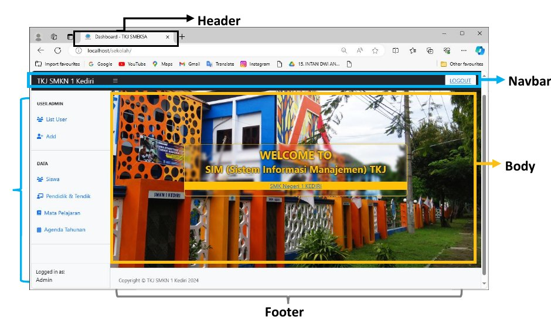

Halaman guest memakai susunan yang sama tanpa sidebar, dengan navbar ikon di bagian atas.

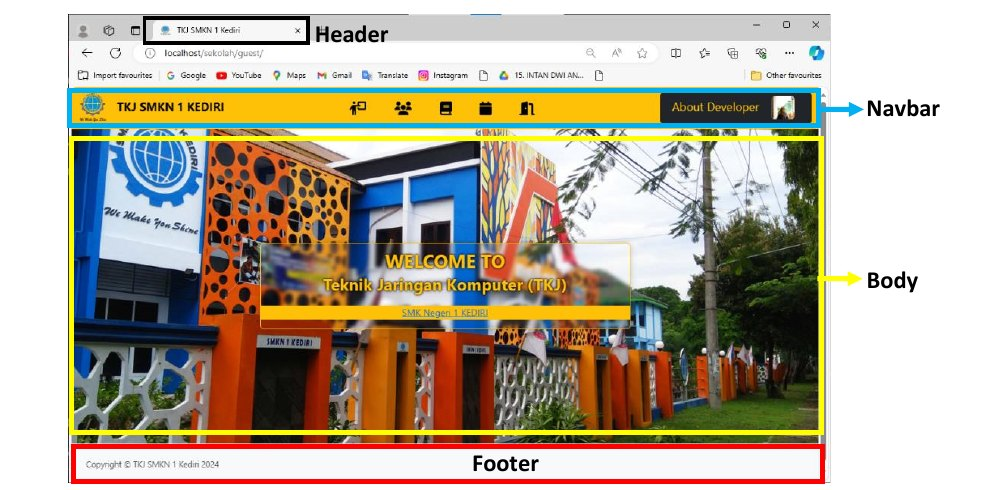

### Halaman Admin (SIM)

Dashboard setelah login sebagai admin — `sekolah/index.php`

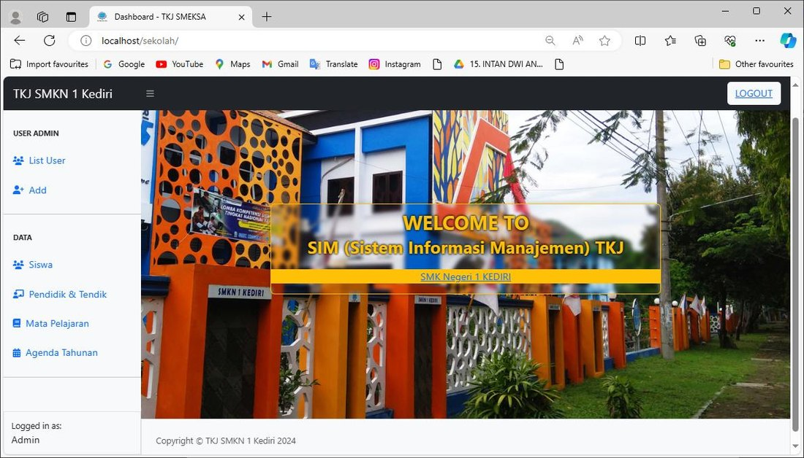

<details>
<summary><b>Modul User Admin</b> — daftar, tambah, ubah password</summary>

**List User** — `user/list-user.php`

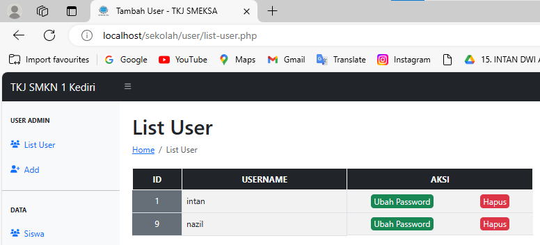

**Tambah Data User** — `user/add-user.php`

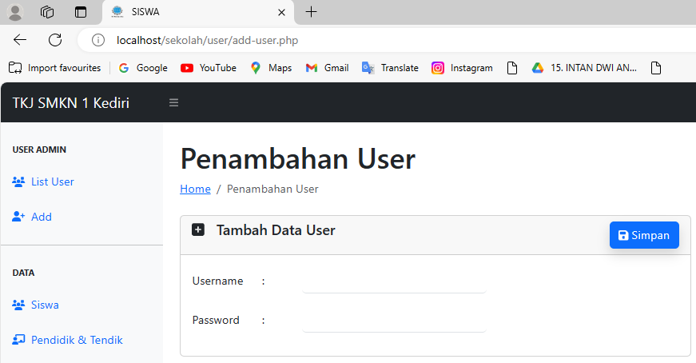

**Ubah Password User** — `user/edit-user.php`

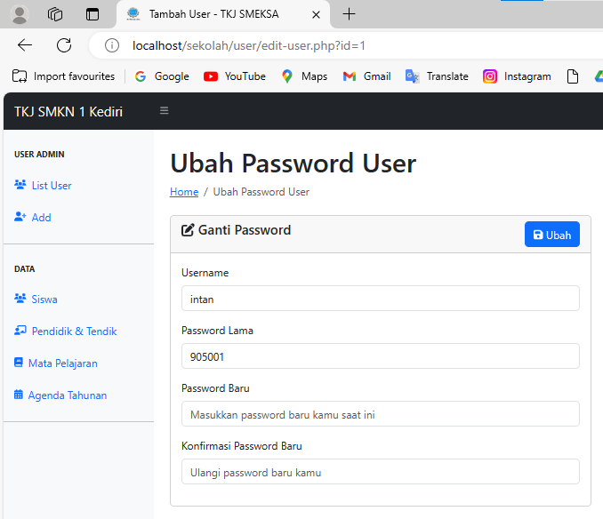

</details>

<details>
<summary><b>Modul Siswa</b> — daftar, tambah, ubah</summary>

**Daftar Siswa** — `siswa/datasiswa.php`

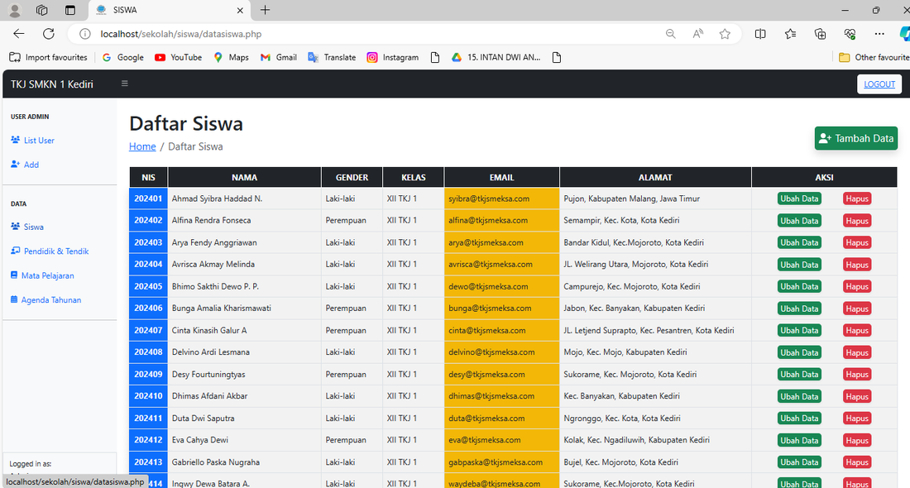

**Tambah Data Siswa** — `siswa/addsiswa.php`

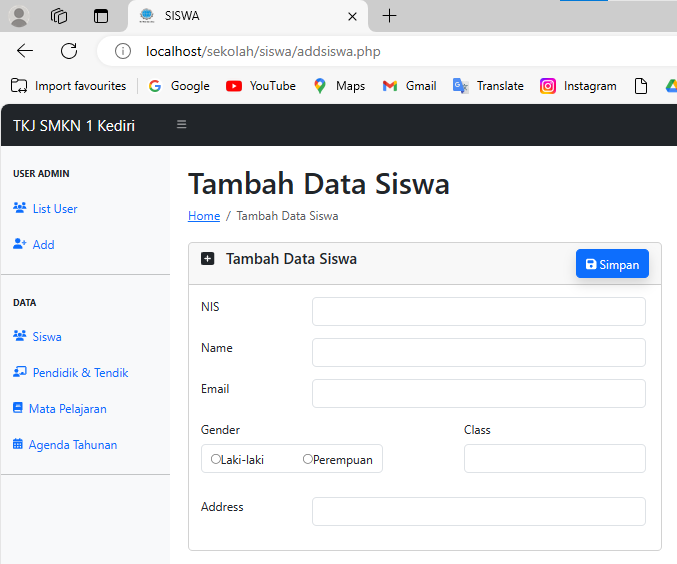

**Ubah Data Siswa** — `siswa/ubahdata.php`

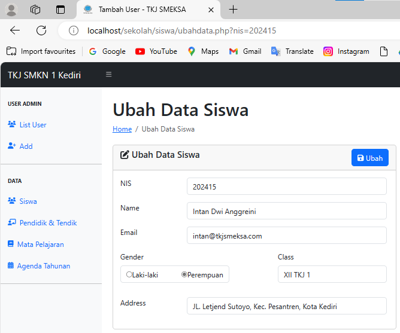

</details>

<details>
<summary><b>Modul Pendidik &amp; Tendik</b> — daftar, tambah, ubah (dengan upload foto)</summary>

**Daftar Guru** — `guru/dataguru.php`

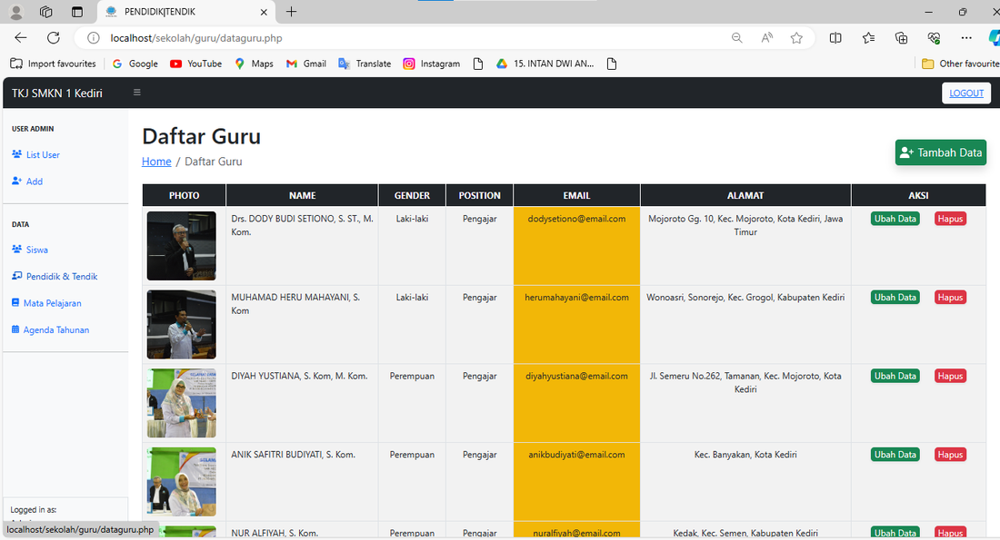

**Tambah Data Pendidik & Tendik** — `guru/addguru.php`

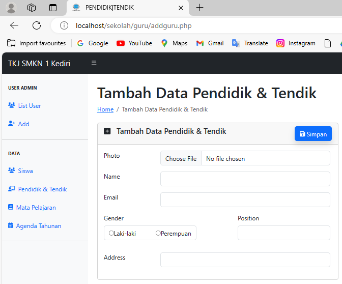

**Ubah Data Pendidik & Tendik** — `guru/ubahdata.php`. Foto lama tetap tampil; kalau tidak memilih file baru, foto itu yang dipakai.

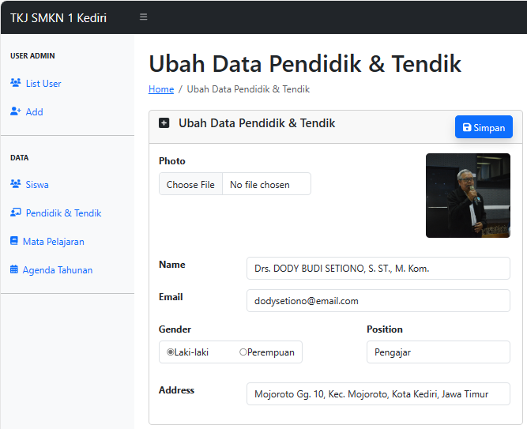

</details>

<details>
<summary><b>Modul Mata Pelajaran</b> — daftar, tambah, ubah</summary>

**Daftar Mata Pelajaran** — `mapel/datamapel.php`

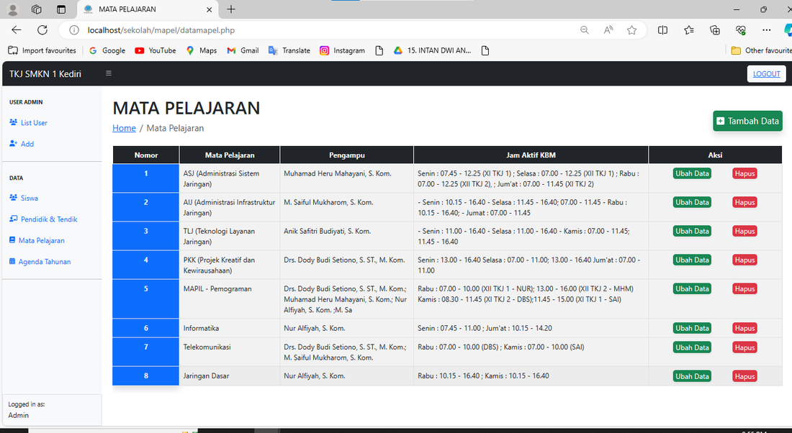

**Tambah Mata Pelajaran** — `mapel/addmapel.php`

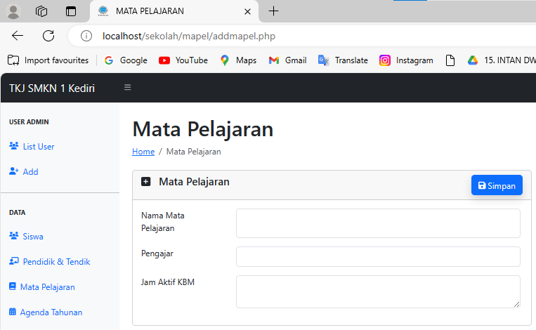

**Ubah Data Mata Pelajaran** — `mapel/ubahmapel.php`

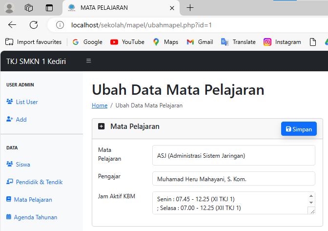

</details>

<details>
<summary><b>Modul Agenda Tahunan</b> — daftar, tambah, ubah (dengan upload dokumentasi)</summary>

**Daftar Agenda Tahunan** — `agenda/agenda.php`

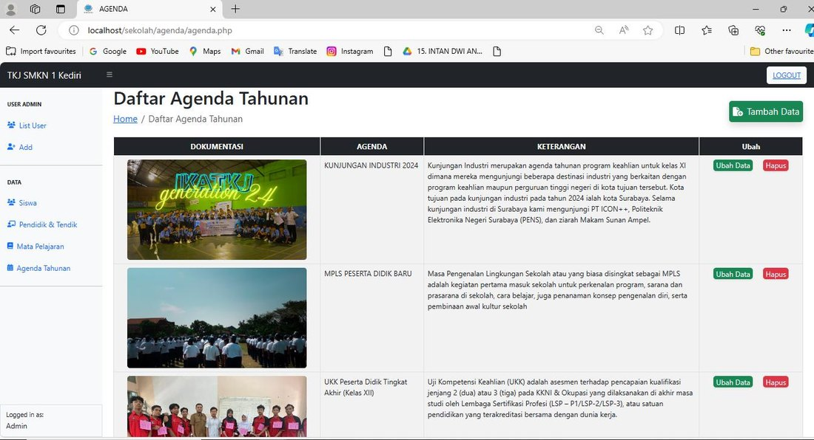

**Tambah Agenda Tahunan** — `agenda/addagenda.php`

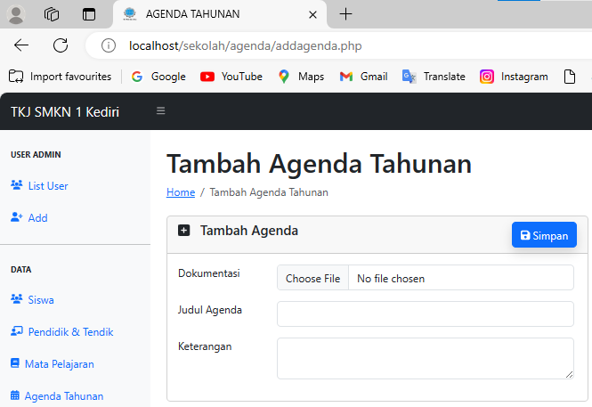

**Ubah Data Agenda Tahunan** — `agenda/ubahagenda.php`

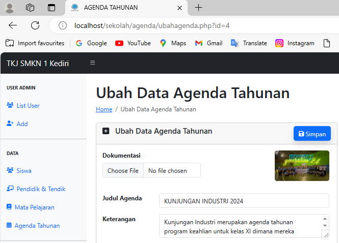

</details>

### Halaman Guest (Siswa & Guru)

Beranda guest — `sekolah/guest/index.php`

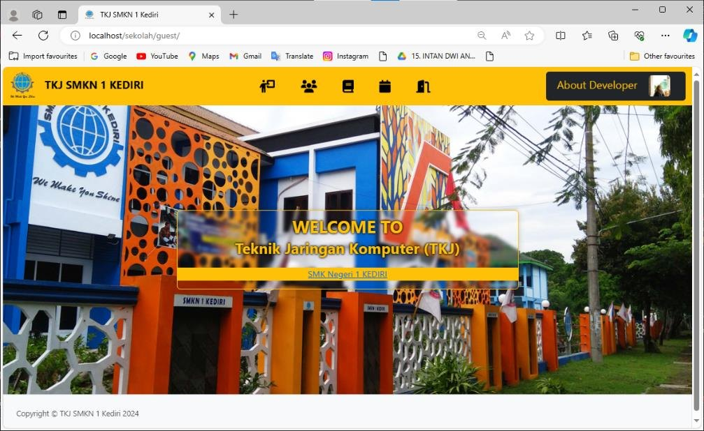

<details>
<summary><b>Halaman data guest</b> — pendidik &amp; tendik, siswa, mata pelajaran, agenda</summary>

**Pendidik & Tendik** — `guest/guru/index.php`

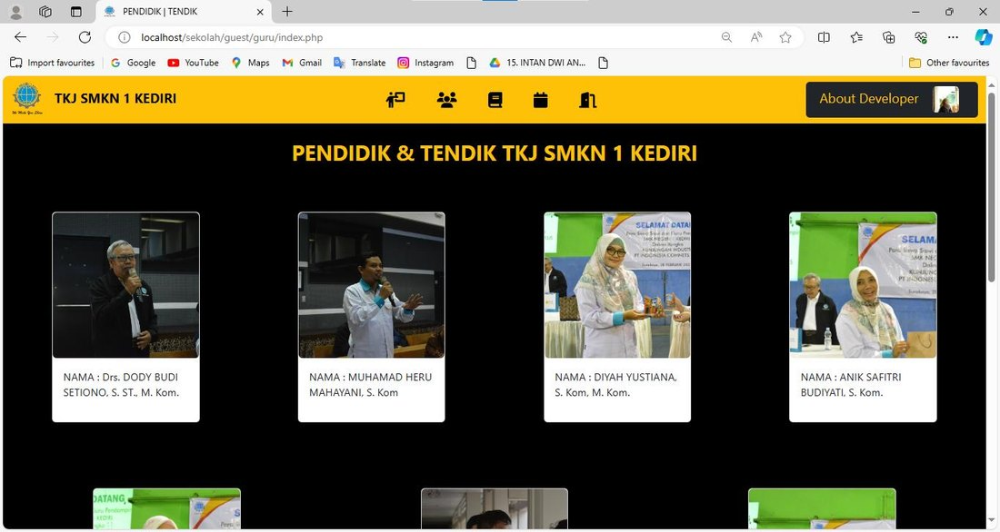

**Daftar Siswa** — `guest/siswa/index.php`

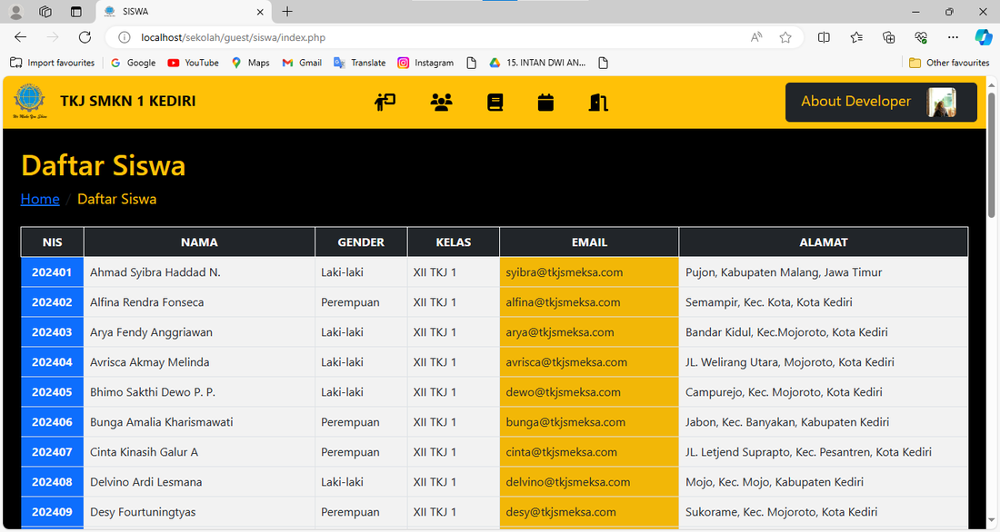

**Mata Pelajaran** — `guest/mapel/index.php`

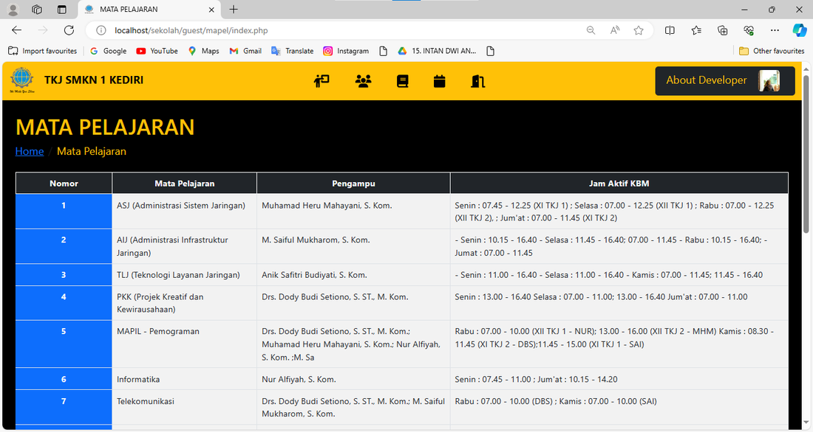

**Agenda Tahunan** — `guest/agenda/index.php`

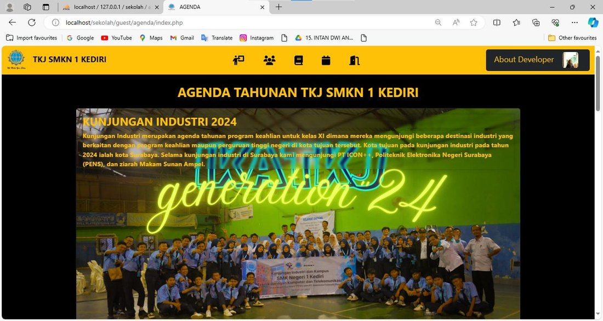

</details>

---

## Teknologi

| Bagian | Teknologi |
|---|---|
| Backend | PHP 8.2 (ekstensi `mysqli`) |
| Database | MySQL 8.0 (kompatibel MariaDB / XAMPP) |
| Frontend | Bootstrap 5, template SB Admin, Font Awesome |
| Web server | Apache (image resmi `php:8.2-apache`) |
| Container | Docker + Docker Compose |
| Manajemen DB | phpMyAdmin 5.2 |

---

## Menjalankan dengan Docker

### Prasyarat

- [Docker Desktop](https://www.docker.com/products/docker-desktop/) (Windows/macOS) atau Docker Engine + Docker Compose v2 (Linux)
- Port **8080** dan **8081** belum dipakai aplikasi lain (bisa diganti lewat `.env`)

### Langkah

```bash
# 1. Masuk ke folder proyek
cd web-mis-sekolah

# 2. (Opsional) salin pengaturan lalu sesuaikan port/password
cp .env.example .env

# 3. Build image & jalankan semua container
docker compose up -d --build

# 4. Cek status — tunggu sampai mis-db berstatus "healthy"
docker compose ps
```

Pada saat pertama dijalankan, MySQL otomatis mengimpor `database/sekolah.sql` (membutuhkan ±20–30 detik).

| Layanan | Alamat |
|---|---|
| Web MIS | http://localhost:8080 |
| phpMyAdmin | http://localhost:8081 (server `db`, user `mis` / `mis123` atau `root` / `root123`) |

---

## Akun Default

Login di http://localhost:8080 :

| Peran | Email / Username | Password | Diarahkan ke |
|---|---|---|---|
| Admin | `admin@tkjsmeksa.com` | `admin123` | Halaman SIM (CRUD) |
| Admin (tabel `user`) | `admin` | `admin123` | Halaman SIM (CRUD) |

---

## Database

Nama database: **`sekolah`** (charset `utf8mb4`).

| Tabel | Dipakai oleh | Kolom |
|---|---|---|
| `allin` | Login utama | `id` (PK), `email` (unik), `password`, `level` ENUM('admin','guru','siswa') |
| `user` | Menu User Admin | `id` (PK), `username` (unik), `password` |
| `siswa` | Menu Siswa | `nis` (PK), `nama`, `kelas`, `alamat`, `jeniskelamin` ENUM('Perempuan','Laki-laki'), `email`, `password` |
| `guru` | Menu Pendidik & Tendik | `id` (PK), `nama`, `jabatan`, `jeniskelamin`, `email`, `alamat`, `foto` (nama file), `password` |
| `mapel` | Menu Mata Pelajaran | `id` (PK), `nama`, `pengampu`, `jamkbm` |
| `agendatahunan` | Menu Agenda Tahunan | `id` (PK), `gambar` (nama file), `agenda`, `deskrip` |

---

## Docker Command

| Keperluan | Command |
|---|---|
| Menjalankan | `docker compose up -d` |
| Melihat log aplikasi / error PHP | `docker compose logs -f web` |
| Menghentikan (data tetap tersimpan) | `docker compose down` |
| Menerapkan perubahan kode di `src/` | `docker compose up -d --build` |
| Reset total database ke data awal | `docker compose down -v` lalu `docker compose up -d --build` |
| Backup database | `docker compose exec db mysqldump -umis -pmis123 sekolah > backup.sql` |
| Restore database | `docker compose exec -T db mysql -umis -pmis123 sekolah < backup.sql` |
| Masuk ke konsol MySQL | `docker compose exec db mysql -umis -pmis123 sekolah` |

Data tersimpan di Docker volume:

- `db_data` — isi database MySQL
- `foto_guru` — foto guru hasil upload (`sekolah/guru/foto`)
- `gambar_agenda` — dokumentasi agenda hasil upload (`sekolah/agenda/gambar`)

---

## Menjalankan Tanpa Docker (XAMPP)

1. Salin **isi** folder `src/` ke `C:\xampp\htdocs\` sehingga strukturnya menjadi:
   ```
   htdocs/
   ├── index.php
   ├── login.php
   ├── logout.php
   ├── koneksi.php
   ├── home.png
   └── sekolah/
   ```
   Aplikasi memakai path `/index.php` dan `/sekolah/...`, jadi folder `sekolah` harus berada langsung di `htdocs`.
2. Jalankan **Apache** dan **MySQL** dari XAMPP Control Panel.
3. Buka http://localhost/phpmyadmin → tab **Impor** → pilih `database/sekolah.sql` → **Kirim**.
4. Buka http://localhost/ lalu login dengan [akun default](#akun-default).

Tanpa environment variable, aplikasi otomatis memakai koneksi default XAMPP: host `localhost`, user `root`, tanpa password, database `sekolah`.

---

## Alur Aplikasi

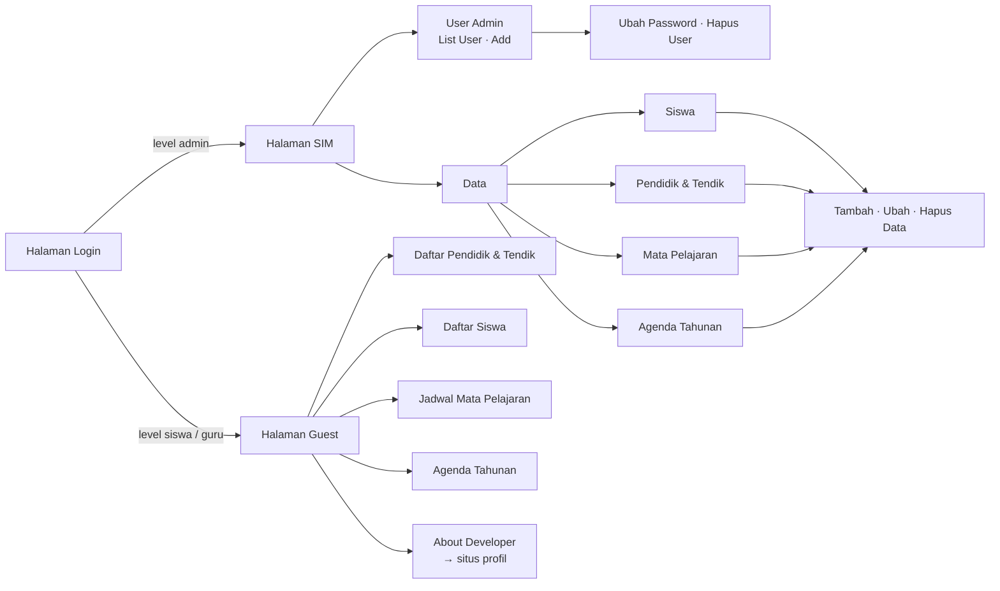

Hak akses halaman diatur di `src/sekolah/config.php`:

| Halaman | Siapa yang boleh |
|---|---|
| `/index.php`, `/sekolah/auth/*` | Semua orang |
| `/sekolah/guest/*` | Sudah login (admin, guru, siswa) |
| Halaman `/sekolah/*` lainnya | Hanya admin |

---

## Environment Variable

| Variabel | Default | Keterangan |
|---|---|---|
| `WEB_PORT` | `8080` | Port Web MIS di komputer host |
| `PMA_PORT` | `8081` | Port phpMyAdmin |
| `DB_USER` | `mis` | User MySQL untuk aplikasi |
| `DB_PASS` | `mis123` | Password user MySQL aplikasi |
| `DB_ROOT_PASS` | `root123` | Password root MySQL |
| `PROFILE_URL` | `#` | Alamat situs profil developer untuk tombol **About Developer** |


## Penyusun

**Intan Dwi Anggreini** — Teknik Jaringan Komputer dan Telekomunikasi, SMK Negeri 1 Kediri
Jl. Veteran No. 9, Mojoroto, Kota Kediri, Jawa Timur
